# AURA TALENT AI — Manual de usuario e instalación

Versión 1.0 · Octubre 2026

AURA TALENT AI es una plataforma de gestión del talento, empleabilidad, orientación profesional y
reclutamiento asistido por IA. Al centro de la experiencia hay una inteligencia visual 3D —el núcleo AURA—
alrededor de la cual existen módulos completos para candidatos, empresas y administradores.

> **Principio de diseño:** AURA es un sistema de **apoyo a decisiones**. Nunca contrata, rechaza ni
> descarta a nadie automáticamente. Cada estimación incluye su explicación, los datos que usó y sus
> limitaciones, y las decisiones finales siempre las toma una persona autorizada.

---

## Contenido

1. [Qué es AURA](#1-qué-es-aura)
2. [Instalación paso a paso](#2-instalación-paso-a-paso)
3. [Arranque diario y cuentas](#3-arranque-diario-y-cuentas)
4. [Conocer la interfaz](#4-conocer-la-interfaz)
5. [Guía para candidatos](#5-guía-para-candidatos)
6. [Guía para empresas](#6-guía-para-empresas)
7. [Guía para el administrador](#7-guía-para-el-administrador)
8. [Voz, cámara y gestos](#8-voz-cámara-y-gestos)
9. [Privacidad y tus datos](#9-privacidad-y-tus-datos)
10. [Publicar en producción](#10-publicar-en-producción)
11. [Solución de problemas](#11-solución-de-problemas)
12. [Anexo: comandos, pruebas y estructura](#12-anexo-comandos-pruebas-y-estructura)

---

## 1. Qué es AURA

AURA conecta tres mundos dentro de una sola plataforma:

| Para candidatos | Para empresas | Para administradores |
|---|---|---|
| Perfil profesional y pasaporte de evidencias de habilidades | Publicar vacantes transparentes y confirmar vigencia | Roles y permisos |
| Portfolio público con enlace propio | Pipeline con plazo de respuesta orientativo | Catálogos de habilidades |
| Constructor y analizador de CV con PDF descargable | Compatibilidad explicada por candidato | Instrumentos de evaluación |
| Búsqueda y postulación a vacantes | Evaluaciones para candidatos | Registro de auditoría |
| Evaluaciones técnicas, situacionales y de orientación | Analítica de reclutamiento | Registro de motores de IA |
| AURA Match: compatibilidad explicada | Reportes en PDF y Excel | |
| Career Map con rutas de aprendizaje en 3D | | |
| Recomendaciones de cursos, vacantes y rutas | Importación/exportación CSV de vacantes | |
| Ensayo de entrevista privado | | |
| Voz, cámara y control por gestos | | |

**Cómo "piensa" AURA.** Los motores de Match y recomendaciones comparan lo que declara el perfil con lo
que pide la vacante o el rol objetivo y explican sus factores. Cuando la persona activa «IA externa»,
Gemini puede clasificar frases libres; si no, se mantienen los comandos por reglas. Ningún modelo toma
la decisión de contratar o rechazar: las decisiones finales siguen siendo humanas.

**Privacidad por diseño.** La cámara y los gestos se procesan por completo en el navegador: ninguna imagen
sale del equipo. De la voz solo viaja el texto reconocido, nunca el audio. Los resultados psicométricos
solo los ve la persona, salvo que decida compartirlos.

---

## 2. Instalación paso a paso

### 2.1 Requisitos

| Componente | Versión | Dónde obtenerlo |
|---|---|---|
| Windows | 10 u 11 | — |
| PostgreSQL | 18 | postgresql.org |
| Python | 3.12 | python.org |
| Node.js | 24 | nodejs.org |
| Navegador | Chrome o Edge recientes | — |

> Chrome o Edge son obligatorios para las funciones de voz y visión. El resto de la plataforma funciona
> en cualquier navegador moderno.

### 2.2 Crear la base de datos

Abre **PowerShell** y ejecuta (ajusta la clave de la aplicación, `MiClaveSegura123`):

```powershell
cd "C:\ruta\al\proyecto\database"
& "C:\Program Files\PostgreSQL\18\bin\psql.exe" -U postgres -v app_password="MiClaveSegura123" -f install.sql
```

`install.sql` ejecuta en orden: crea el rol `aura_app` y la base `aura_talent` (`00`), el esquema,
los datos iniciales, los recursos de aprendizaje (`03`) y la migración idempotente de transparencia y
pasaporte (`04`). En una base ya instalada, aplica únicamente la migración nueva:

```powershell
& "C:\Program Files\PostgreSQL\18\bin\psql.exe" -U aura_app -d aura_talent -f 04_trust_and_portability.sql
```

Esta migración añade campos de beneficios, horario, plazos de respuesta y confirmación de vigencia a
vacantes, además de la tabla `skill_evidence`. Es idempotente y no borra ni reconstruye datos existentes.

### 2.3 Configurar el backend

```powershell
cd "C:\ruta\al\proyecto\backend"
py -3.12 -m venv .venv
.venv\Scripts\python -m pip install -r requirements-dev.txt
copy .env.example .env
```

Edita `backend\.env` y completa al menos:

```ini
DB_PASSWORD=MiClaveSegura123
JWT_SECRET=genera-una-clave-aleatoria-de-32-caracteres-o-mas
```

Para generar una `JWT_SECRET` segura:

```powershell
.venv\Scripts\python -c "import secrets; print(secrets.token_urlsafe(48))"
```

### 2.4 Configurar el frontend

```powershell
cd "C:\ruta\al\proyecto\frontend"
npm.cmd install
```

> En Windows usa siempre `npm.cmd` dentro de PowerShell: `npm.ps1` está bloqueado por la política de
> ejecución.

### 2.5 Crear los usuarios de demostración

Con la base lista, desde `backend\`:

```powershell
.venv\Scripts\python -m app.scripts.seed_demo
```

Crea las tres cuentas de la sección siguiente, todas con la contraseña `AuraDemo2026`.

### 2.6 Verificar la instalación

Arranca ambos servidores (ver sección 3) y abre `http://localhost:5173/api/docs` en el navegador:
debe mostrar la documentación interactiva del API. Luego abre `http://localhost:5173` e inicia sesión.

---

## 3. Arranque diario y cuentas

### 3.1 Arrancar la plataforma

Se necesitan **dos ventanas de PowerShell**, una por cada parte.

**Ventana 1 — backend:**

```powershell
cd "C:\ruta\al\proyecto\backend"
.venv\Scripts\python -m uvicorn app.main:app --reload --port 8000
```

**Ventana 2 — frontend:**

```powershell
cd "C:\ruta\al\proyecto\frontend"
npm.cmd run dev
```

Abre `http://localhost:5173` en Chrome o Edge. Para detener cualquiera de los dos, pulsa **Ctrl + C** en
su ventana.

### 3.2 Cuentas de demostración

| Cuenta | Rol | Qué puedes ver |
|---|---|---|
| `candidato@aura.dev` | Candidato | Perfil, pasaporte de habilidades, CV, vacantes, evaluaciones, Match, Career Map, ensayo privado y Mi progreso |
| `reclutador@auralabs.dev` | Reclutador (empresa Aura Labs) | Vacantes, candidatos, pipeline, evaluaciones, Match, Analytics, Reportes |
| `sysadmin@aura.dev` | Administrador del sistema | Roles, catálogos, instrumentos, modelos de IA, auditoría |

Contraseña de todas: `AuraDemo2026`.

### 3.3 Datos de demostración realistas

Para ver las analíticas, el pipeline y el Match con datos de verdad, hay un script que crea un proceso
completo (perfil con experiencia, 3 vacantes publicadas, 7 candidatas/os postulados en distintas etapas,
una evaluación calificada, un CV y una ruta profesional):

```powershell
cd "C:\ruta\al\proyecto\backend"
.venv\Scripts\python -m app.scripts.seed_showcase
```

Todo pasa por el API real, con las mismas validaciones que la interfaz. Si ya existen las vacantes de
demostración, el script no duplica nada.

---

## 4. Conocer la interfaz

### 4.1 El arranque

Al abrir la aplicación por primera vez se muestra la secuencia de arranque: el núcleo AURA se enciende
mientras se inicializa el núcleo 3D. Solo aparece una vez por sesión.


### 4.2 Acceso y registro

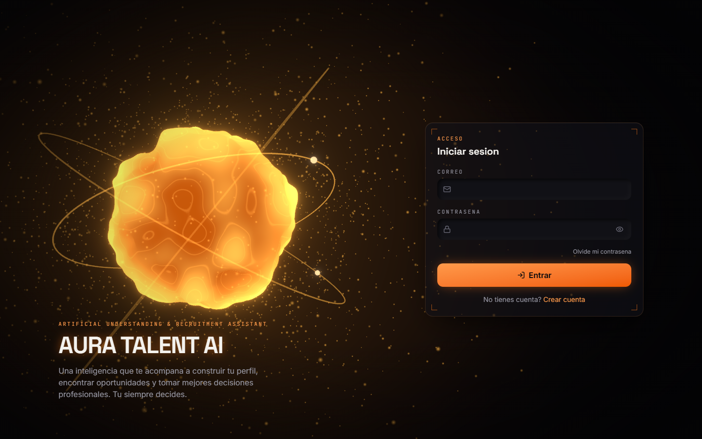

Inicio de sesión con correo y contraseña. La sesión usa tokens de acceso cortos con renovación
automática: si llevas tiempo dentro no necesitas volver a entrar. Tras cinco intentos fallidos la cuenta
se bloquea durante 15 minutos.

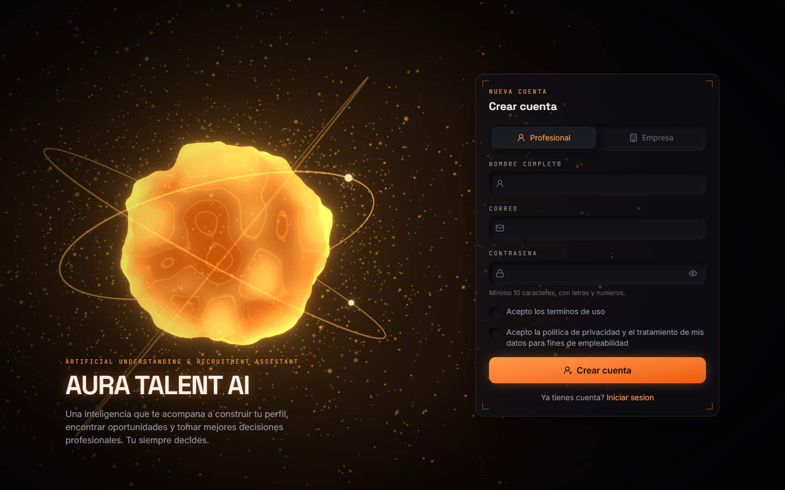

Al registrarte eliges el tipo de cuenta: **Busco trabajo** (candidato) o **Contrato talento** (empresa).
Es obligatorio aceptar los términos y la política de privacidad.

### 4.3 El espacio de trabajo

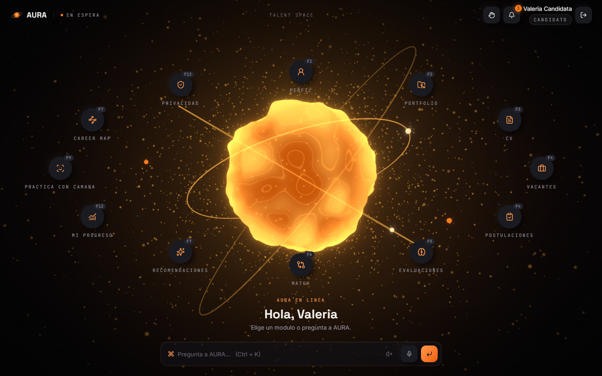

La pantalla principal tiene tres elementos:

1. **El núcleo AURA** (izquierda): la esfera 3D. Cambia de color, energía y forma según lo que esté
   pasando. Es un indicador de estado, no solo decoración.
2. **El módulo activo** (derecha): el panel de trabajo.
3. **La barra de comandos** (abajo): para hablar o escribir a AURA.

En la barra superior: activar gestos (icono de mano), notificaciones (campana con contador), tu rol y
cerrar sesión.

**Los estados del núcleo:**

| Estado | Aspecto | Cuándo aparece |
|---|---|---|
| En espera | Naranja suave, respiración lenta | Reposo |
| Escuchando | Más activo, reacciona a tu voz | Micrófono abierto |
| Pensando | Girando más rápido | Procesando un comando |
| Analizando | Ámbar intenso | Análisis de CV, perfil o match |
| Hablando | Pulsos rítmicos | Respondiendo en voz alta |
| Visión | Azulado | Cámara encendida |
| Gestos | Verde lima | Mano detectada |
| Exito | Destello verde + onda expansiva | Acción completada |
| Aviso | Destello ámbar + onda | Algo que revisar |
| Error | Destello rojo + onda | Algo falló |

Efectos adicionales del núcleo: **sigue tu puntero** con la mirada, emite una **onda expansiva** cada vez
que una acción termina (ámbar si fue bien, roja si hubo error), un **anillo** que ondula con la voz
mientras escuchas o habla, y **satélites** que orbitan por cada notificación sin leer.

### 4.4 La barra de comandos

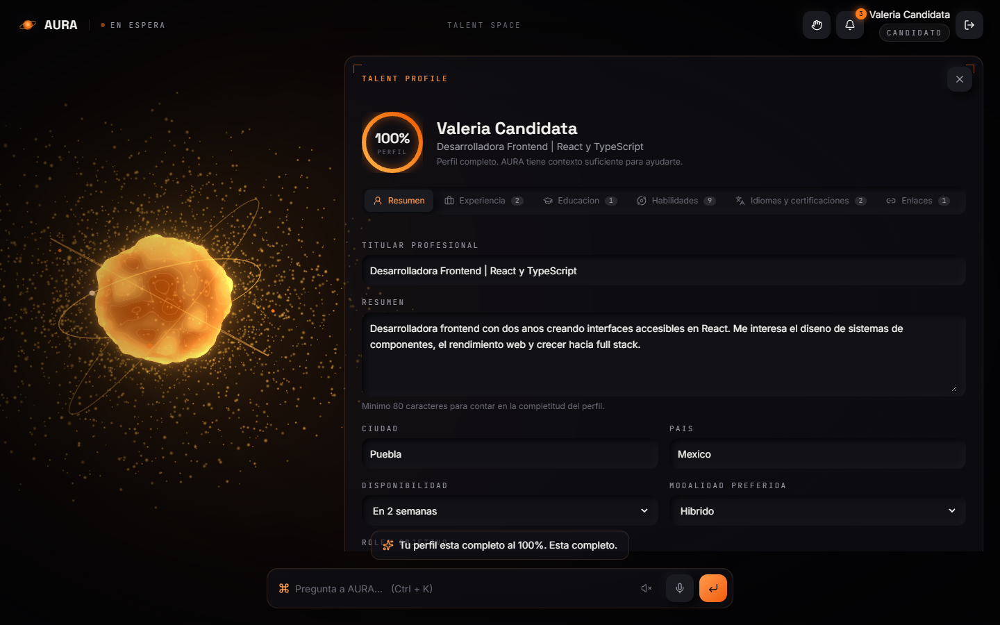

Escribe (o dicta) lo que quieras: abrir un módulo, pedir un análisis o lanzar una acción. Atajo:
**Ctrl + K** enfoca la barra; **Ctrl + Shift + Espacio** activa el micrófono.

Ejemplos:

| Dices o escribes | Qué hace AURA |
|---|---|
| "Abre mi perfil" / "llévame a vacantes" | Navega al módulo |
| "Analiza mi perfil" | Completitud y qué te falta |
| "¿Qué habilidades necesito mejorar?" | Tus brechas frente al mercado |
| "Busca vacantes de frontend" | Lista vacantes compatibles |
| "Compara mi perfil con esta vacante" | Compatibilidad explicada |
| "Genera una ruta profesional" | Pide confirmación y la crea |
| "Genera un reporte de mi perfil" | Te lleva al PDF |
| "Resume las candidaturas de esta vacante" (empresa) | Panorama de postulaciones |
| "¿Qué puedes hacer?" | Lista de comandos disponibles |

Las acciones que crean datos (CV, ruta) siempre piden **confirmación** antes de ejecutarse, con una
ventana de 5 minutos y de un solo uso. Cada cuenta solo puede usar los comandos de su rol.

**Frases libres con Gemini.** Además de las frases de ejemplo, AURA entiende lenguaje natural: si las
reglas no reconocen tu frase y tienes activado el permiso **«IA externa»** (módulo Privacidad), el texto
del comando —solo el texto, nunca tu perfil ni audio— se envía a Gemini, que elige el comando más
adecuado dentro de tu lista permitida. Aunque el modelo sugiera un comando que no te corresponde, la
plataforma lo rechaza: la IA propone, los permisos mandan. Si Gemini no está configurado o no das el
consentimiento, todo sigue funcionando con las frases por reglas.

### 4.5 Instalarla como aplicación (PWA)

AURA es una aplicación web progresiva: en Chrome/Edge aparece el icono de instalación en la barra de
direcciones, o en el menú de tres puntos → "Instalar AURA". Queda en el escritorio como una app propia.
Tus datos siempre se piden a la red; el service worker nunca guarda respuestas del API.

También funciona en el teléfono:

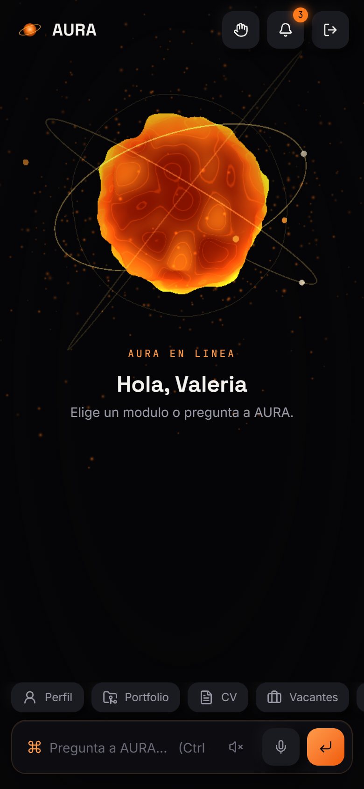

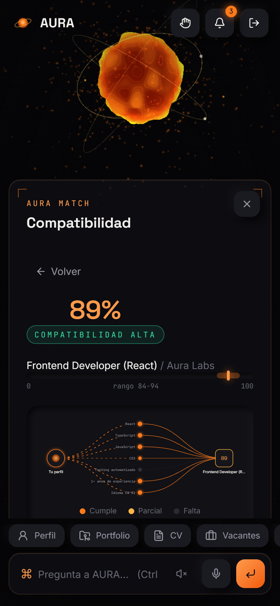

---

## 5. Guía para candidatos

### 5.1 Perfil profesional

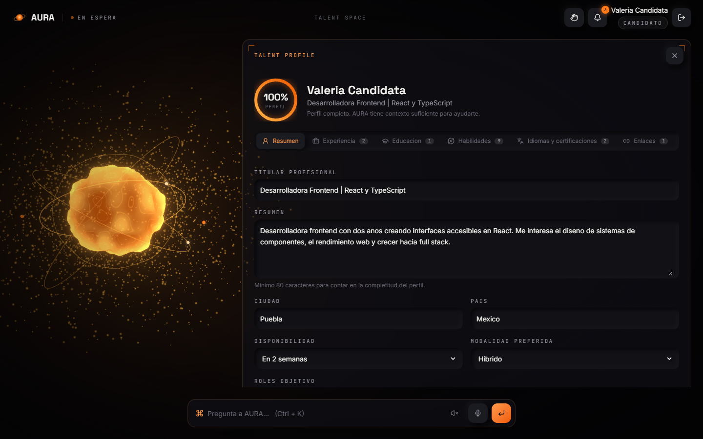

El módulo **Perfil** resume tu información: titular, resumen, ubicación, disponibilidad, modalidad de
trabajo preferida y roles deseados. El porcentaje de **completitud** se recalcula con cada cambio y
explica qué secciones te faltan.

Debajo hay secciones para experiencia, educación, idiomas, certificaciones y enlaces. A la derecha, el
análisis de AURA: fortalezas, qué mejorar y sugerencias concretas.

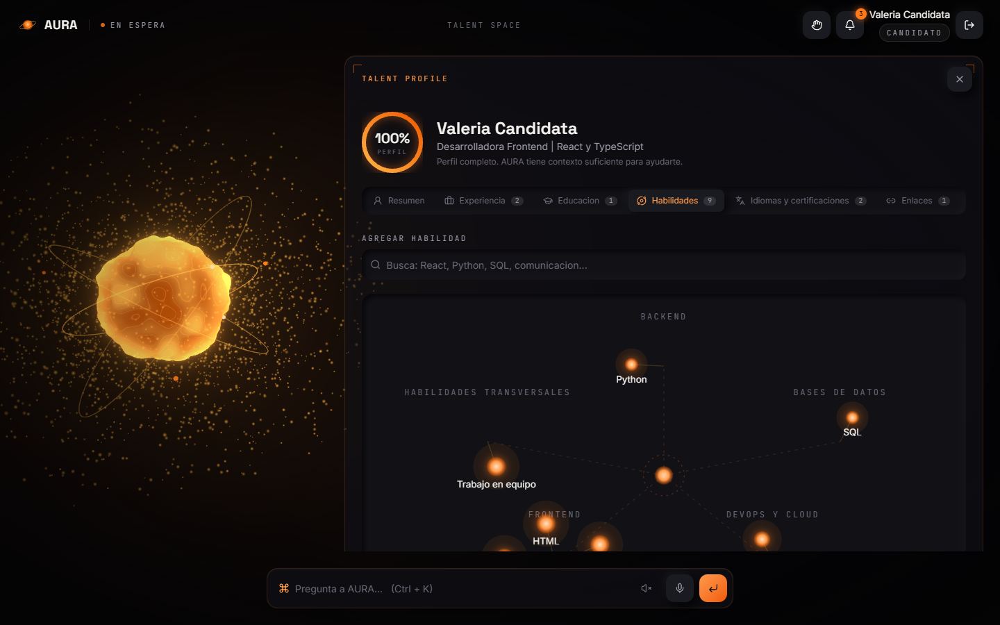

En la pestaña **Habilidades** agregas habilidades del catálogo (busca por nombre, incluye alias:
"js" encuentra JavaScript) y les asignas un nivel del 1 al 5. La **constelación de habilidades** las
muestra ordenadas por nivel.

> Las habilidades son la base de todo: el Match, las brechas, las recomendaciones y las rutas se
> calculan comparándolas con lo que piden las vacantes y los roles.

#### Pasaporte de habilidades

En **Pasaporte de habilidades** puedes vincular una habilidad del perfil con un proyecto, muestra de
trabajo, certificado, credencial o enlace. También puedes importar el resumen de una insignia Open Badges
3.0 en JSON. AURA guarda los datos que aportas, pero **no verifica criptográficamente** la firma, el
emisor ni la autenticidad del archivo; la interfaz y el pasaporte exportado lo indican claramente.

Cada evidencia se mantiene privada por defecto. Si activas **Compartir con empresas**, aparecerá solo en
las postulaciones que tú envíes y en la ficha de esa candidatura; no se añade al perfil público. Puedes
revocar el permiso o borrar la evidencia. **Descargar pasaporte JSON** crea un resumen portable, no una
insignia oficial ni una certificación emitida por AURA.

### 5.2 Portfolio

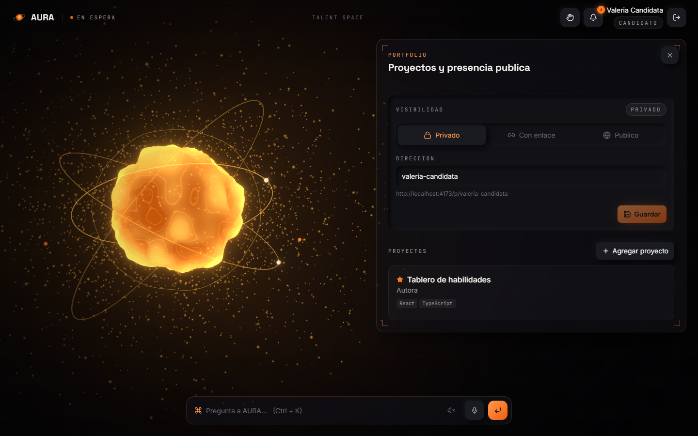

Agrega proyectos con título, descripción, tu rol, enlaces y las habilidades que demuestran. Elige qué
quieres destacar. Activa el **enlace público** para obtener una URL propia (`/p/tu-usuario`) que puedes
compartir; puedes apagarla cuando quieras.

### 5.3 Curriculum

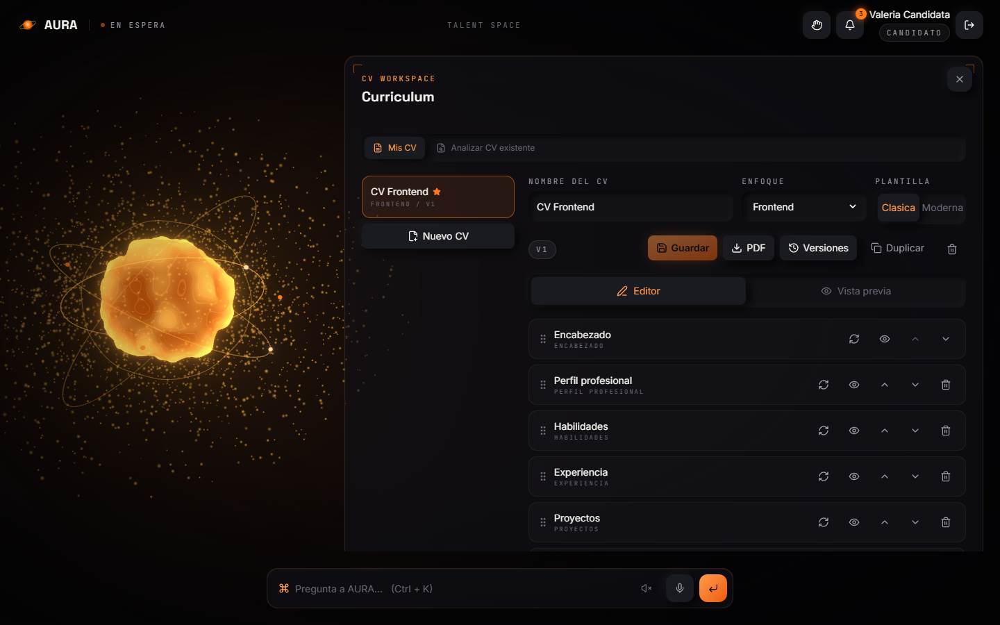

El módulo **CV** tiene dos partes:

**Crear un CV desde tu perfil:**

1. En la pestaña **Mis CV**, escribe un nombre, elige el **enfoque** (general, frontend, backend, datos,
   prácticas, software o personalizado) y la plantilla (Clásica o Moderna). Pulsa **Nuevo CV**.
2. Cada enfoque ordena y pondera las secciones de distinta forma: por ejemplo, el enfoque frontend pone
   proyectos y habilidades técnicas primero.

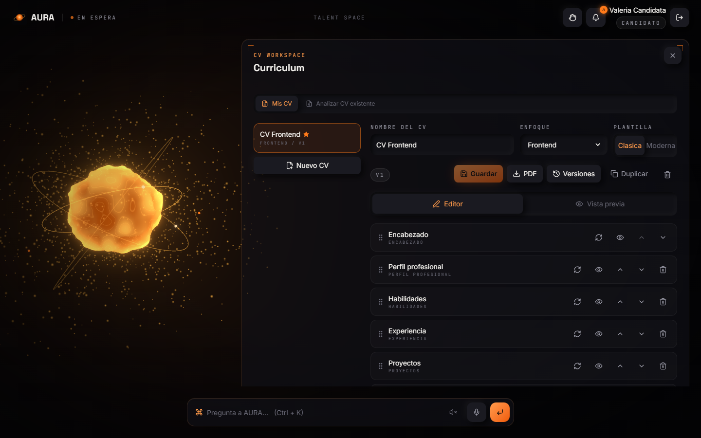

3. En el editor cada sección se puede **sincronizar con el perfil** (icono circular), mostrar u ocultar
   (ojo), reordenar (flechas) o eliminar. Las secciones de texto también se editan a mano.
4. **Vista previa** muestra el documento tal como saldrá. **PDF** lo descarga con texto real seleccionable
   y formato legible por sistemas de reclutamiento (ATS).
5. Cada guardado crea una **versión**; puedes volver a cualquier versión anterior y **duplicar** el CV
   para adaptarlo a otra vacante.

**Analizar un CV existente:**

1. En **Analizar CV existente**, sube un PDF o DOCX.
2. AURA extrae secciones, habilidades, experiencia, educación e idiomas. Cada dato encontrado indica su
   **evidencia** (el texto del que salió) y su **confianza**.
3. Revisa el análisis y decide qué aplicar a tu perfil: **nada se guarda sin tu confirmación**, y los
   niveles de idioma nunca se inventan.

### 5.4 Vacantes y postulaciones

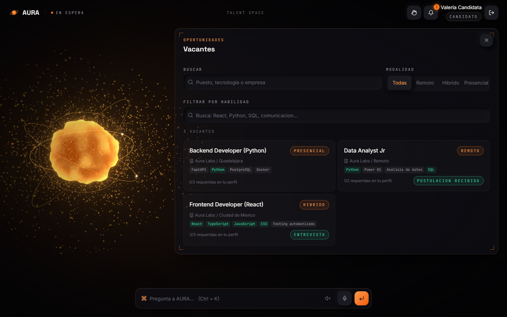

En **Vacantes** buscas por texto, modalidad, ubicación y habilidades. Cada tarjeta muestra la empresa,
el puesto, los requisitos clave y la completitud de la información de la vacante. En el detalle aparecen
salario si la empresa decidió publicarlo, beneficios, horario, plazo orientativo de respuesta, duración
estimada del proceso y cuándo se confirmó por última vez que la vacante seguía activa. Las fechas son
informativas, no garantías. Desde ahí puedes **postularte** —se congela una copia del CV que elijas— o
ver tu compatibilidad explicada.

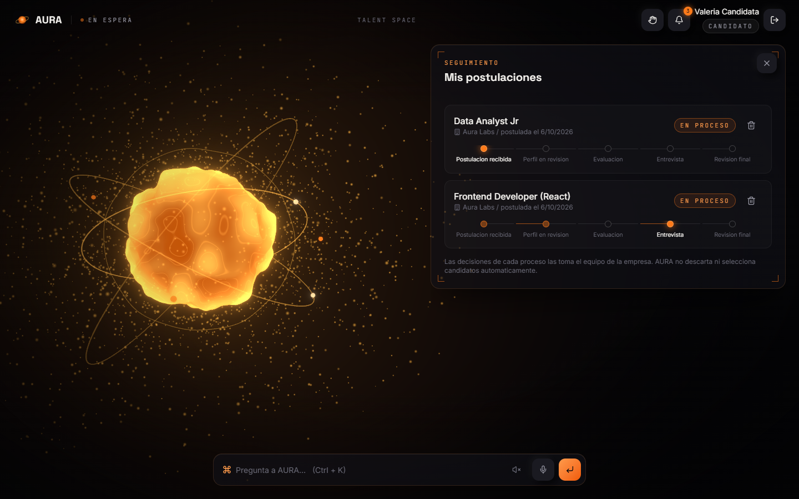

**Mis postulaciones** muestra cada proceso con su línea de progreso: postulación recibida, perfil en
revisión, evaluación, entrevista y revisión final. También muestra la última actualización humana y, si la
empresa configuró un plazo, una fecha orientativa para la siguiente actualización. Si esa fecha pasa, AURA
no cambia el estado ni envía un rechazo: solo informa que todavía no hay novedades.

Desde una postulación activa puedes abrir **Practicar entrevista**. Las preguntas se construyen localmente
a partir de las responsabilidades y habilidades publicadas. Escribes una respuesta y repasas la guía STAR
(Situación, Tarea, Acción, Resultado). Las notas viven solo en la memoria de esa pantalla; no se envían a
la empresa, al servidor ni a Gemini. Puedes borrarlas o descargar un TXT para ti.

### 5.5 Evaluaciones

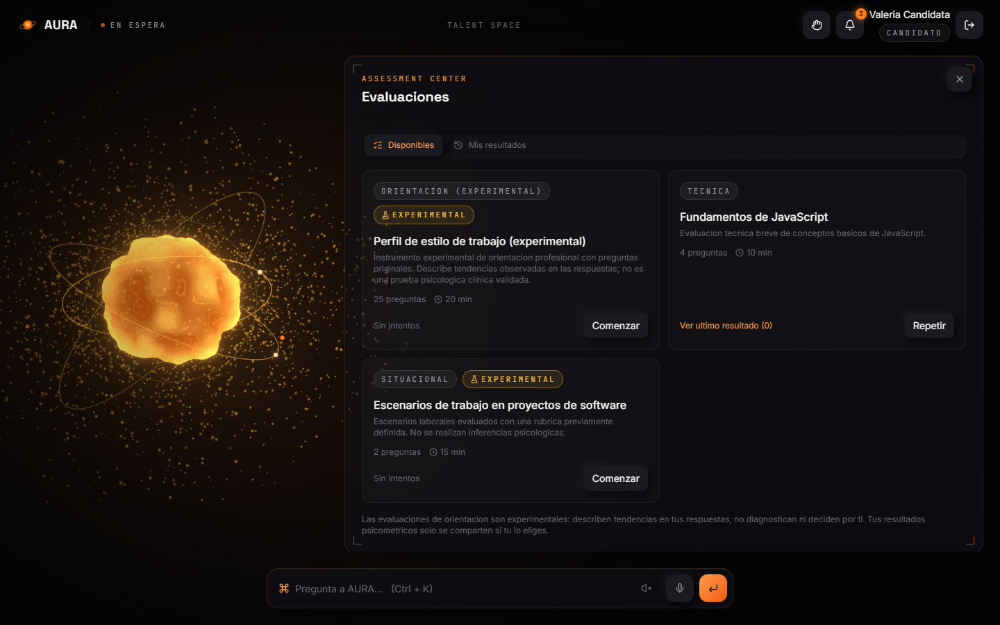

El catálogo muestra las evaluaciones disponibles; las asignadas por una empresa aparecen primero con su
fecha límite. Hay tres tipos:

- **Técnicas**: opción múltiple con respuesta correcta.
- **Situacionales**: escenarios laborales evaluados con rúbrica.
- **De orientación** (psicométrica experimental): escalas de acuerdo; miden preferencias de trabajo.

Al comenzar verás la descripción, las limitaciones y el aviso; la de orientación pide tu consentimiento.
Durante la prueba: respuestas con teclado (1–5 o A–D), guardado automático, posibilidad de retomarla y
cronómetro si hay límite de tiempo.

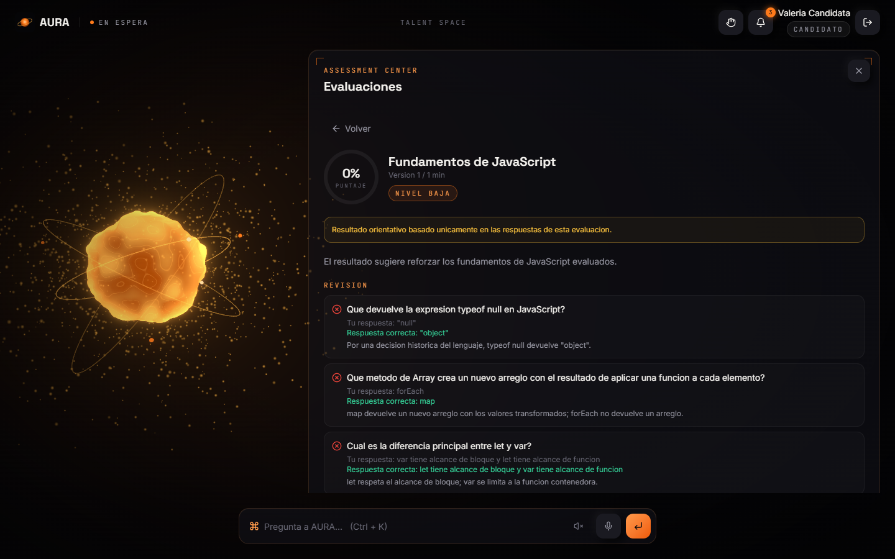

El resultado es siempre **explicable**:

- Técnicas y situacionales: puntaje y revisión pregunta por pregunta con la respuesta correcta y el porqué.
- Orientación: ocho dimensiones con rango, interpretación y recomendaciones, más el aviso de que **no es
  un diagnóstico psicológico**.
- Si las respuestas se ven dudosas (todas iguales o demasiado rápidas) aparece un aviso informativo;
  no penaliza a nadie.

Los resultados de orientación **no se comparten** con ninguna empresa salvo que lo actives en la
postulación concreta.

### 5.6 AURA Match

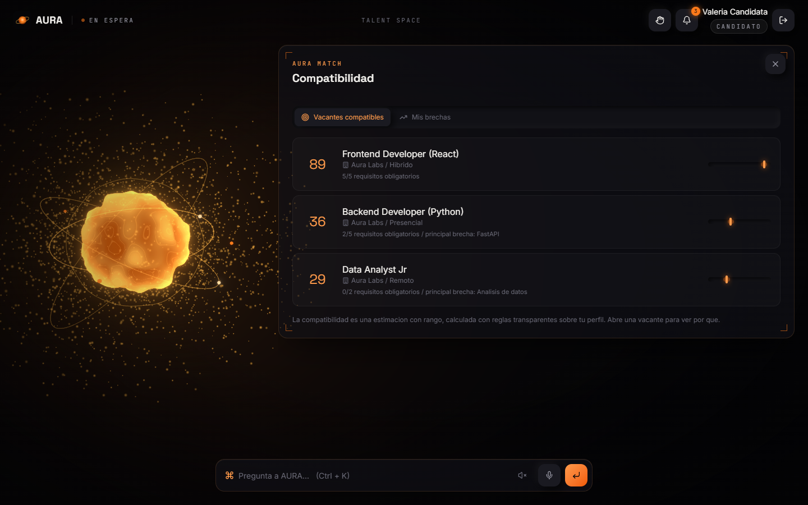

**Match** ordena las vacantes publicadas por tu compatibilidad estimada, siempre como **rango**
(«89%, entre 84 y 94»): si a tu perfil le faltan datos, el rango se abre más.

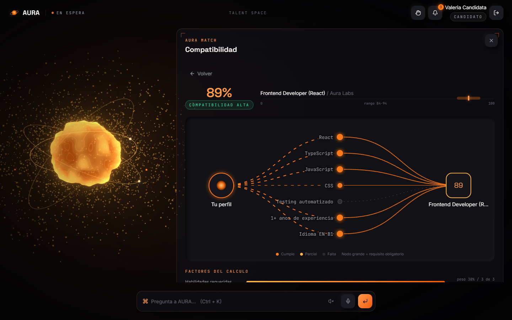

Al abrir una vacante:

- Un **diagrama de nodos**: tu perfil a la izquierda, los requisitos al centro y la vacante a la derecha.
  Cada conexión sale naranja si cumples, ámbar si cumples en parte, gris si falta.
- Barras por factor: habilidades requeridas y deseables, similitud de texto, experiencia, idiomas,
  educación, evaluaciones, certificaciones y modalidad.
- Fortalezas, brechas, sugerencias de mejora y la explicación de cómo se calculó.

La pestaña **Mis brechas** resume qué requisitos te faltan con más frecuencia entre todas las vacantes,
y en cuántas aparecen.

> **Lo que el Match nunca usa:** edad, género, nacionalidad, fotos, resultados psicométricos ni
> expectativa salarial. La compatibilidad es un apoyo, no un filtro: no mueve ni descarta a nadie.

### 5.7 Recomendaciones

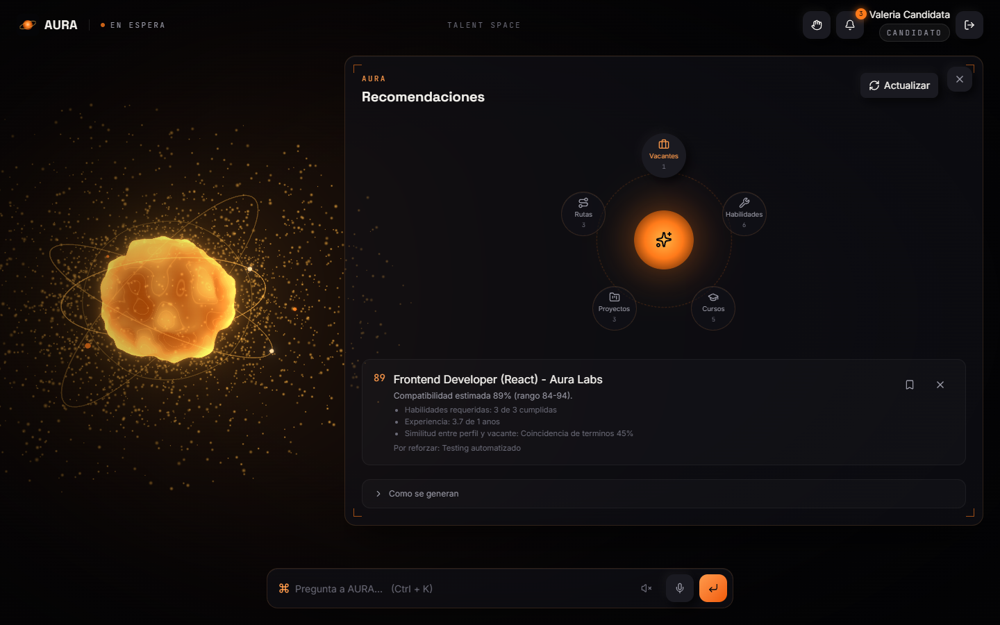

Un núcleo con cinco tipos de sugerencias orbitando: **vacantes, habilidades, cursos, proyectos y rutas**.
Cada una explica por qué se sugiere («aparece como brecha en 3 vacantes»). Puedes **guardarla** o
**descartarla**; lo descartado no vuelve a aparecer.

### 5.8 Career Map

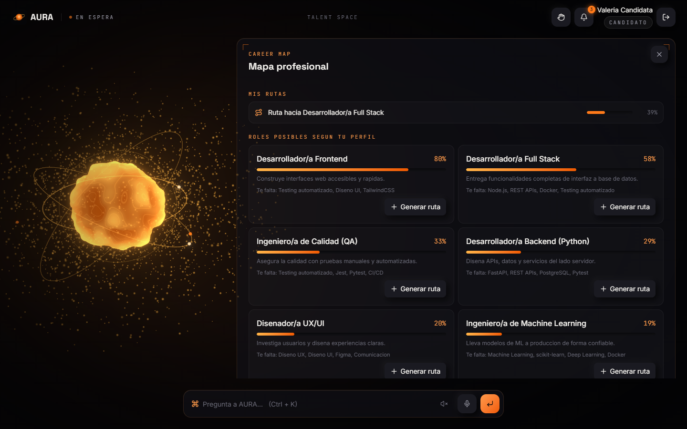

**Career Map** compara tu perfil con nueve roles objetivo (Frontend, Backend, Full Stack, Analista de
Datos, Científico de Datos, Ingeniero de ML, DevOps, Calidad, UX/UI) y te dice qué porcentaje de cada uno
ya cubres.

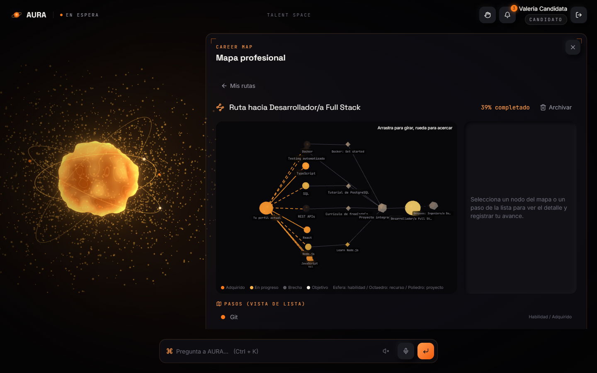

Al generar una ruta obtienes un **mapa 3D interactivo**: tu perfil actual → habilidades que faltan →
recursos gratuitos para cada una → proyecto final → rol objetivo. Gira arrastrando, acerca con la rueda y
haz clic en cualquier nodo para verlo y registrar tu avance. Los colores indican el estado: naranja
adquirido, ámbar en progreso, gris brecha. Debajo hay una **vista de lista** con los mismos pasos.

#### Explorador de algoritmos de búsqueda

Cada ruta incluye un explorador sobre el grafo real del mapa (perfil → habilidades/recursos → proyecto →
rol objetivo). Selecciona BFS, DFS, UCS, GBFS o A* y pulsa **Buscar ruta**:

| Algoritmo | Qué optimiza / cómo explora |
|---|---|
| BFS | Ruta con menor número de aristas; explora por niveles (cola FIFO). |
| DFS | Explora una rama hasta el fondo; con «Todas las rutas» enumera caminos simples mediante backtracking. |
| UCS | Ruta de menor costo acumulado `g`, usando horas del recurso o peso de la arista. |
| GBFS | Prioriza la heurística `h` (distancia restante); es rápido, pero no garantiza el costo mínimo. |
| A* | Prioriza `f=g+h`; la heurística es una cota inferior estimada por distancia restante en aristas. |

El panel muestra el **orden de exploración**, el árbol por niveles de profundidad, las rutas halladas, su
costo estimado, nodos explorados, retrocesos y ciclos evitados. Incluye dos gráficas: visitas por nivel
de profundidad y evolución de `g`, `h` y `f` en los pasos de búsqueda. Pulsa **Reproducir** para animar la
expansión: el nodo activo resplandece, el camino temporal se ilumina y se retrae al retroceder; los
ciclos aparecen como aristas rojas punteadas. Puedes pausar, limpiar la traza, ajustar la velocidad y
el límite de profundidad (1–20). DFS devuelve como máximo 20 rutas para mantener la búsqueda acotada.

Estos costos y heurísticas son **estimaciones del sistema**, no horas garantizadas ni verdades absolutas.
El endpoint autenticado `GET /api/v1/career/paths/{path_id}/search/{bfs|dfs|ucs|gbfs|a_estrella}` solo
consulta rutas propias del candidato. `mode=todas` está disponible para DFS; `limit` define la profundidad.

### 5.9 Mi progreso

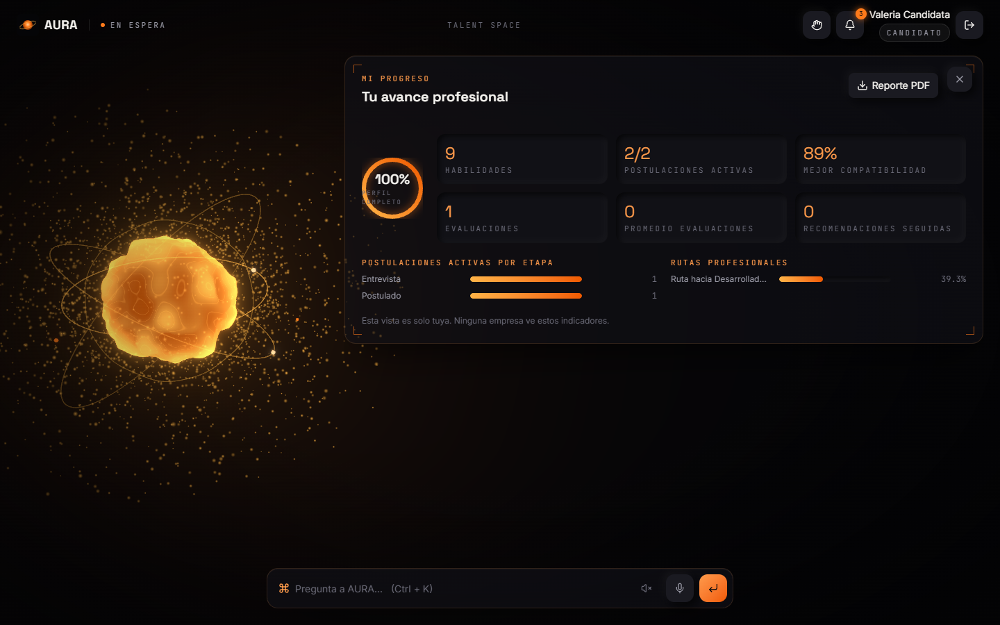

Tu panel personal: completitud del perfil, habilidades, postulaciones activas, mejor compatibilidad,
evaluaciones y promedio, avance en tus rutas profesionales y el resumen de recomendaciones. Incluye el
botón para descargar tu **reporte personal en PDF**.

### 5.10 Privacidad

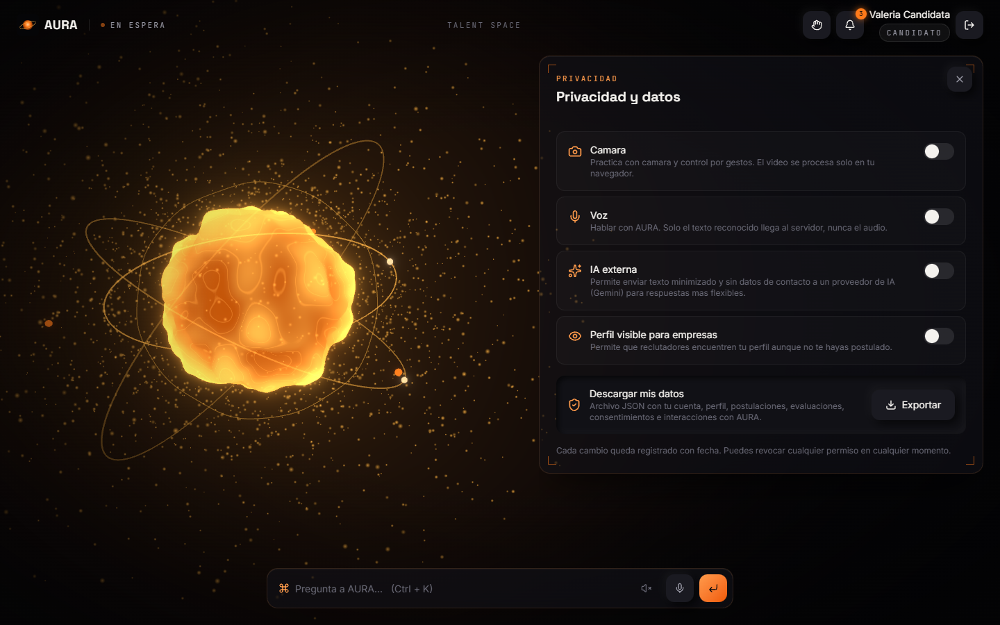

Controla los permisos opcionales —cámara, voz, IA externa, perfil visible para empresas— y **descarga
todos tus datos** en un archivo JSON: cuenta, perfil, postulaciones, evaluaciones, consentimientos e
interacciones con AURA.

---

## 6. Guía para empresas

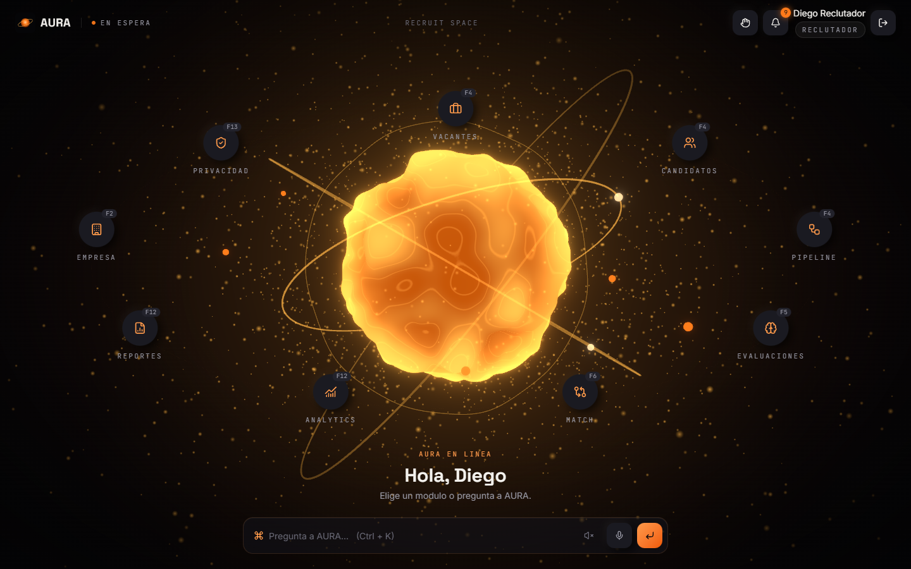

### 6.1 Vacantes

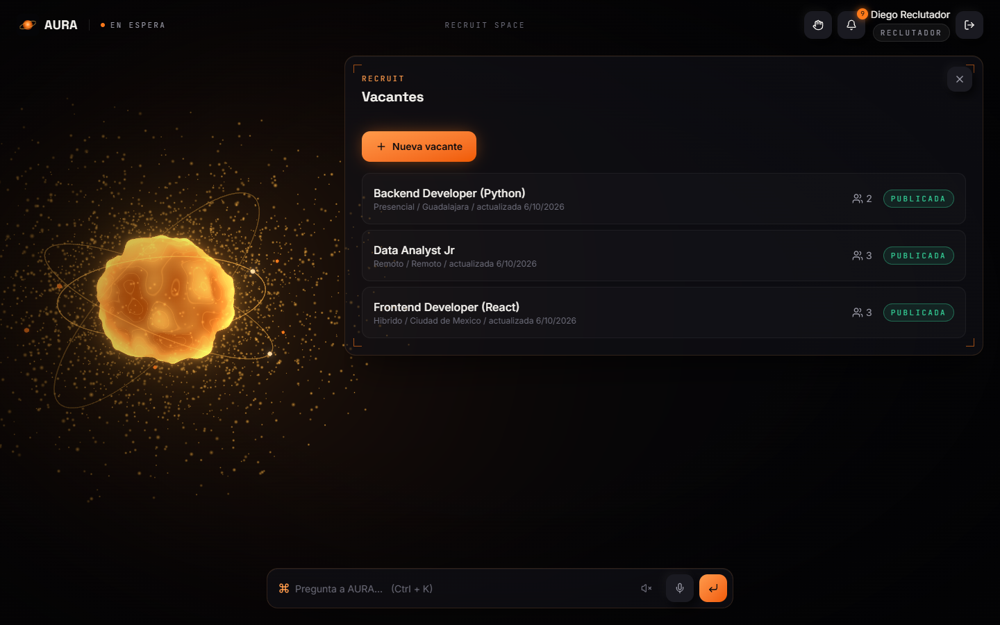

En la lista puedes **exportar CSV** o importar un CSV con el formato exportado por AURA. La importación
valida el contenido y crea hasta 25 borradores por lote; no publica nada automáticamente. Revisa las
habilidades, requisitos, idioma y datos antes de publicar. Las integraciones directas y sincronización
continua con un ATS específico requieren configuración y credenciales del proveedor; el CSV no es una
conexión en tiempo real.

Crea vacantes con título, descripción, modalidad, ubicación, experiencia mínima, habilidades
(obligatorias o deseables con nivel mínimo), idiomas, salario visible opcional, beneficios, horario,
plazo de respuesta esperado y duración estimada del proceso. El detalle muestra un indicador de qué
información importante está publicada; no certifica la veracidad de los datos.

Estados: **borrador, publicada, pausada, cerrada**. Solo las publicadas son visibles para candidatos.
Mientras esté publicada, el equipo puede pulsar **Confirmar vigencia** tras comprobar que sigue abierta;
AURA registra la fecha. En la vista pública, una confirmación de más de 30 días se señala como antigua,
pero AURA no cierra ni oculta la vacante automáticamente. Los puestos importados por CSV se crean
siempre como borradores.

### 6.2 Candidatos y pipeline

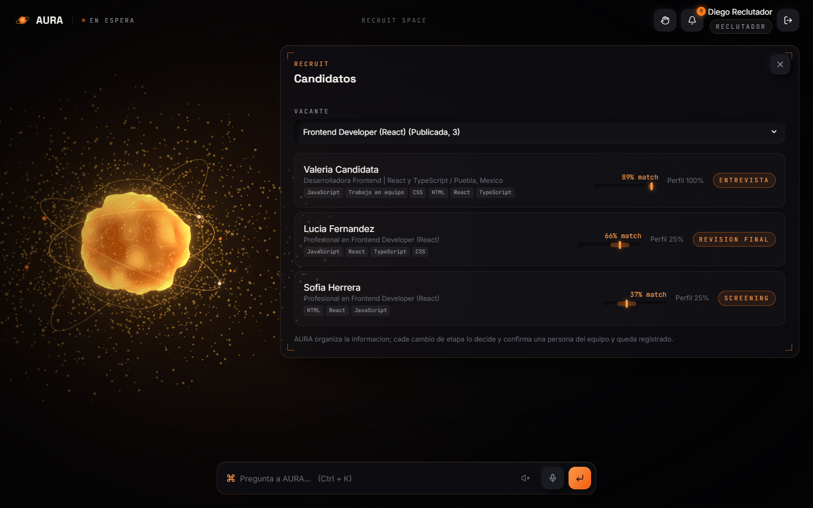

La lista muestra a quienes se postularon, con su etapa actual y su compatibilidad estimada con rango.
El orden por defecto es de llegada: la compatibilidad informa, no ordena ni filtra.

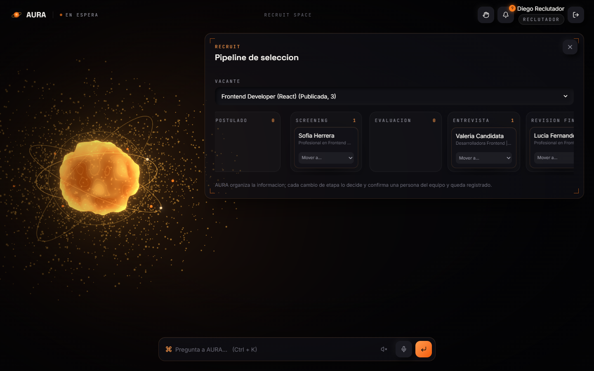

El **pipeline** organiza las postulaciones por etapas. Cada movimiento lo hace una persona del equipo:
seleccionas a dónde mover y el cambio queda en el historial. Para **seleccionar** (contratada) o
**cerrar** se exige motivo y confirmación. El aviso inferior es permanente: AURA organiza la información;
las decisiones son humanas.

### 6.3 La ficha de la postulación

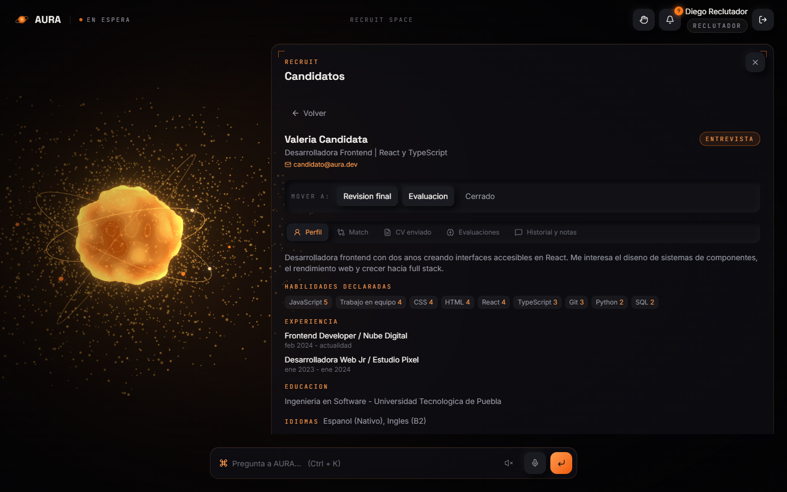

Cinco pestañas:

- **Perfil**: resumen, habilidades declaradas con nivel, experiencia, educación e idiomas. Si el
  candidato decidió compartir evidencias, las verás en una sección separada como aportadas por él y
  explícitamente **no verificadas independientemente por AURA**.
- **Match**: la compatibilidad explicada, factor por factor (ver siguiente captura).
- **CV enviado**: el CV congelado en el momento de postularse.
- **Evaluaciones**: asignar evaluaciones con fecha límite y ver sus resultados (las de orientación solo
  si el candidato las compartió).
- **Historial y notas**: movimientos de etapa y notas internas del equipo. El candidato nunca ve estas
  notas.

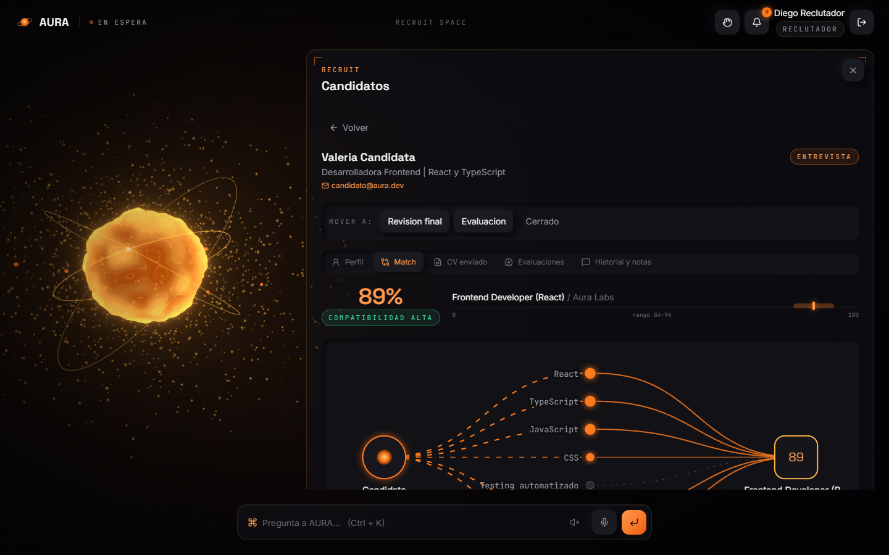

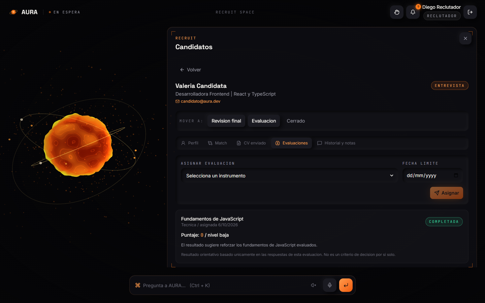

### 6.4 Match de la vacante

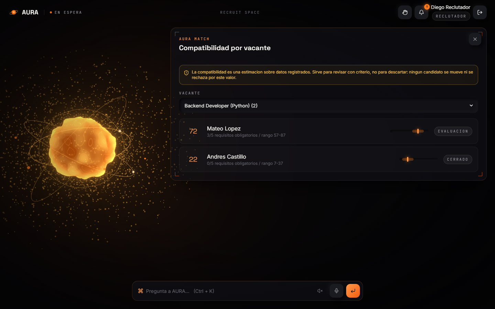

Ordena a los postulantes de una vacante por compatibilidad estimada, con el aviso de que ese valor es
una referencia y no sirve para descartar a nadie.

### 6.5 Analytics

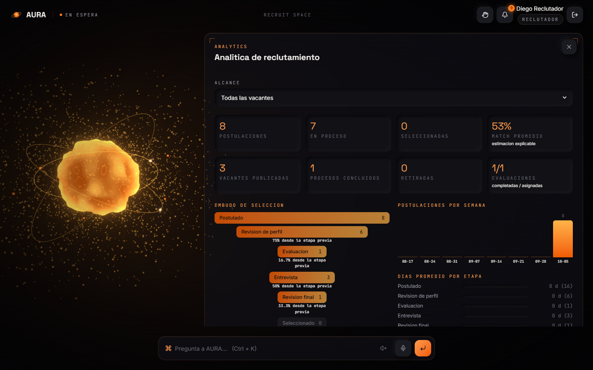

Indicadores del proceso de selección, para todas las vacantes o para una en concreto:

- Contadores: postulaciones, en proceso, seleccionadas, match promedio, vacantes publicadas, procesos
  concluidos, retiradas y evaluaciones completadas/asignadas.
- **Embudo de selección**: cuántas postulaciones llegaron a cada etapa y qué porcentaje avanzó respecto
  a la anterior. Las etapas que se pueden saltar (como Evaluación) no distorsionan el cálculo.
- Postulaciones por semana (últimas 8) y días promedio en cada etapa.
- Habilidades más frecuentes entre postulantes y **brechas** más comunes (requisitos que casi nadie
  declara).
- Si hay menos de 5 postulaciones aparece un aviso de muestra pequeña.

### 6.6 Intercambio CSV de vacantes

En la vista de vacantes de empresa puedes **exportar** tus vacantes a CSV e **importar** un archivo del
mismo formato. La importación admite hasta 25 filas y crea solo borradores; nunca publica en lote.
Revisa habilidades, idiomas y requisitos antes de publicar. El CSV incluye esos campos en JSON dentro
de sus columnas para que una exportación e importación dentro de AURA los conserve.

Esto es intercambio portable, no sincronización directa con un ATS. Para una integración en tiempo real
con Greenhouse, Lever u otro proveedor se necesitarían credenciales, permisos y un conector específico
aprobado por la empresa.

### 6.7 Reportes

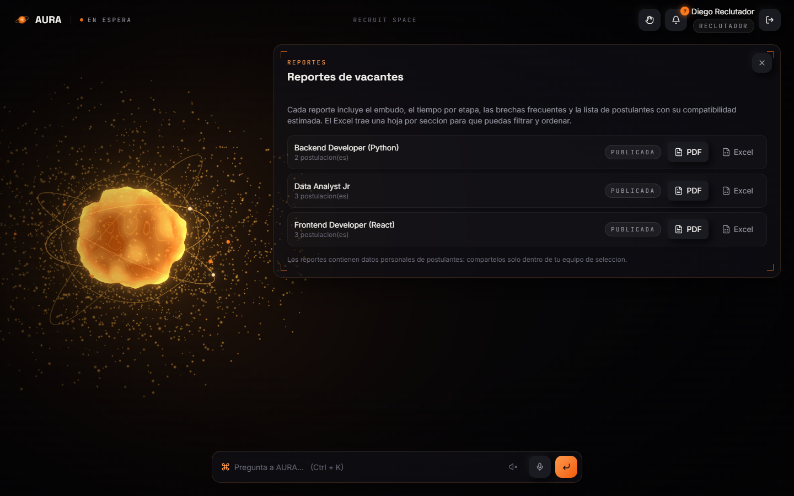

Para cada vacante, descarga un reporte con indicadores, embudo, días por etapa, habilidades y brechas,
en dos formatos:

- **PDF**: documento de lectura, con metodología y limitaciones.
- **Excel**: una hoja por sección, lista para filtrar.

Cada reporte queda registrado con su fecha. Solo contiene datos de tu empresa.

### 6.8 Evaluaciones y perfil de empresa

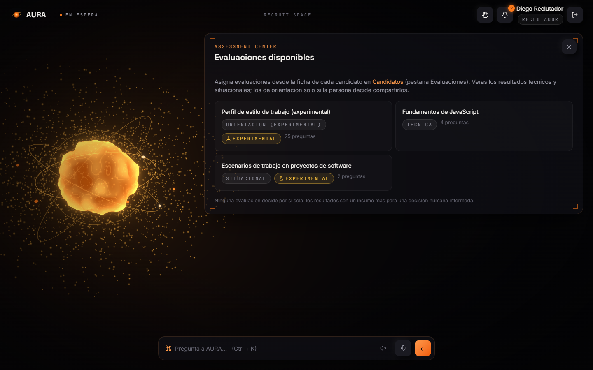

Vista de los instrumentos que puedes asignar (se asignan desde la ficha de cada postulación).

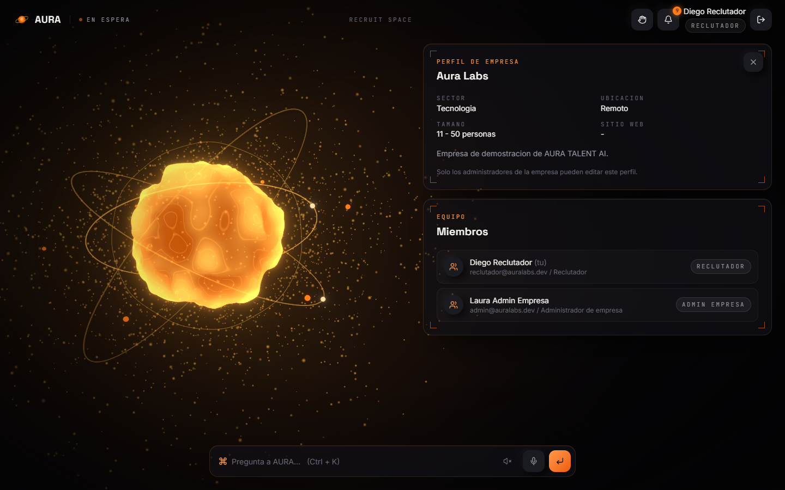

Datos de la empresa (nombre, sector, descripción, sitio web) y gestión de miembros: cada persona del
equipo puede tener rol de administradora, reclutadora o revisora.

---

## 7. Guía para el administrador

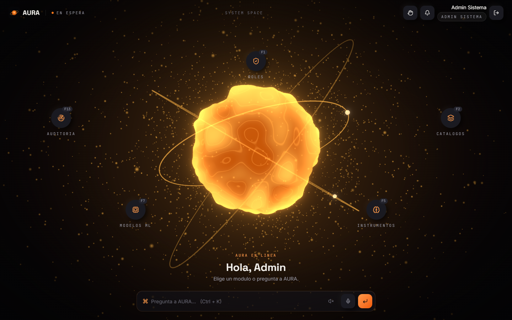

### 7.1 Auditoría

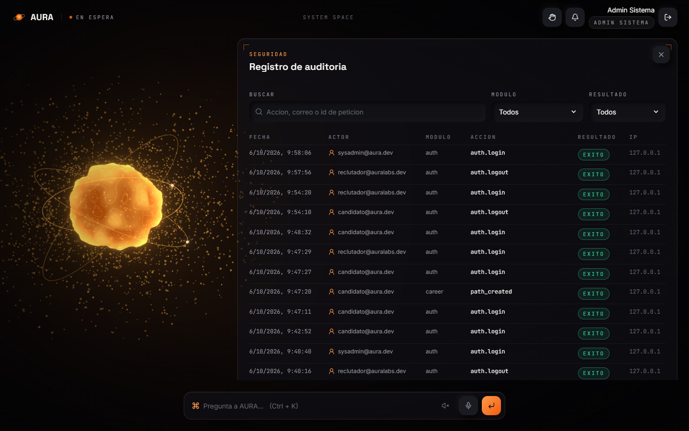

Registro de **quién hizo qué, cuándo y con qué resultado**: inicios de sesión, accesos denegados, cambios,
comandos de AURA, exportaciones. Filtra por módulo, resultado o texto libre (acción, correo o id de
petición). Es **de solo lectura**: nadie, ni el administrador, puede modificarlo ni borrarlo desde la
plataforma. El administrador de empresa solo ve eventos de su empresa; el del sistema lo ve todo.

### 7.2 Modelos de IA

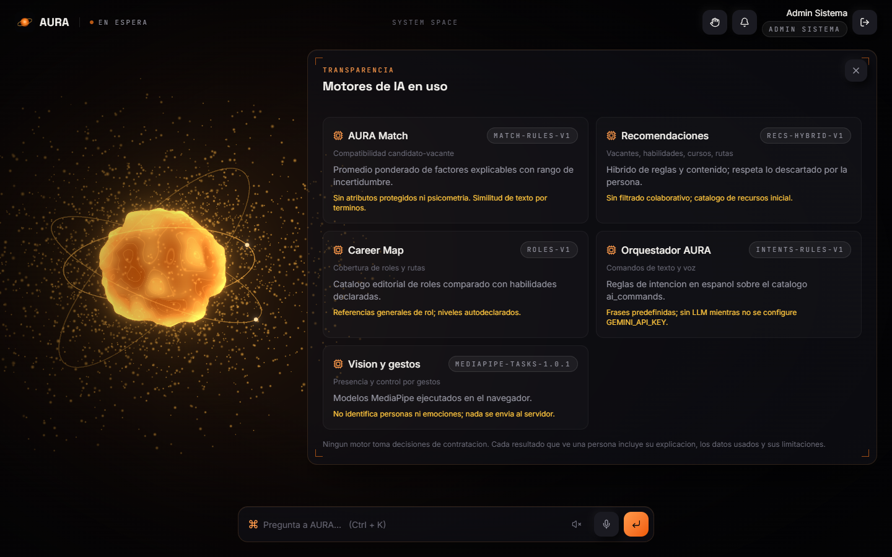

Registro de **todos los motores de decisión** en uso: nombre, versión, qué hace, cómo funciona y sus
limitaciones. Es la transparencia de la plataforma hecha interfaz, y la referencia para auditorías
externas.

### 7.3 Instrumentos, roles y catálogos

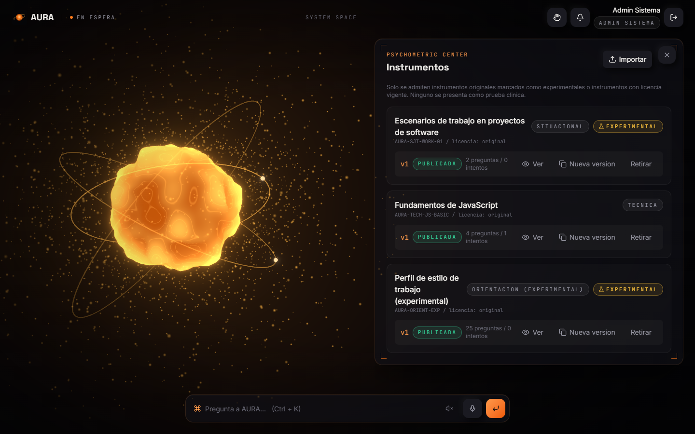

Administra los instrumentos de evaluación y sus versiones. Una versión **publicada es inmutable**: para
cambiarla se clona a borrador, se edita y se publica (la anterior queda retirada). También puedes
importar instrumentos nuevos pegando su definición JSON.

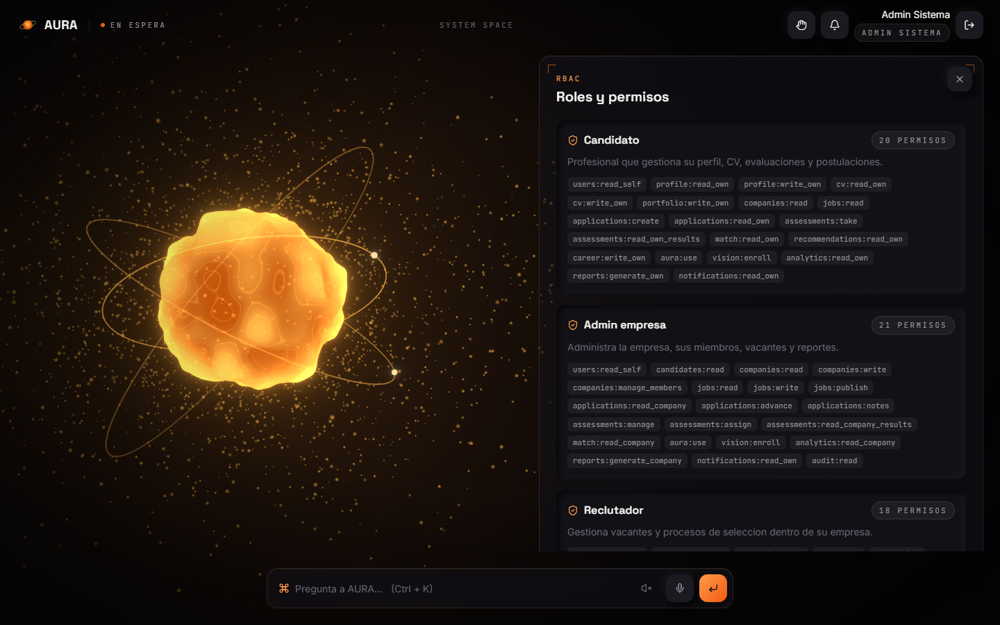

Roles del sistema con su descripción y la lista de permisos que incluye cada uno.

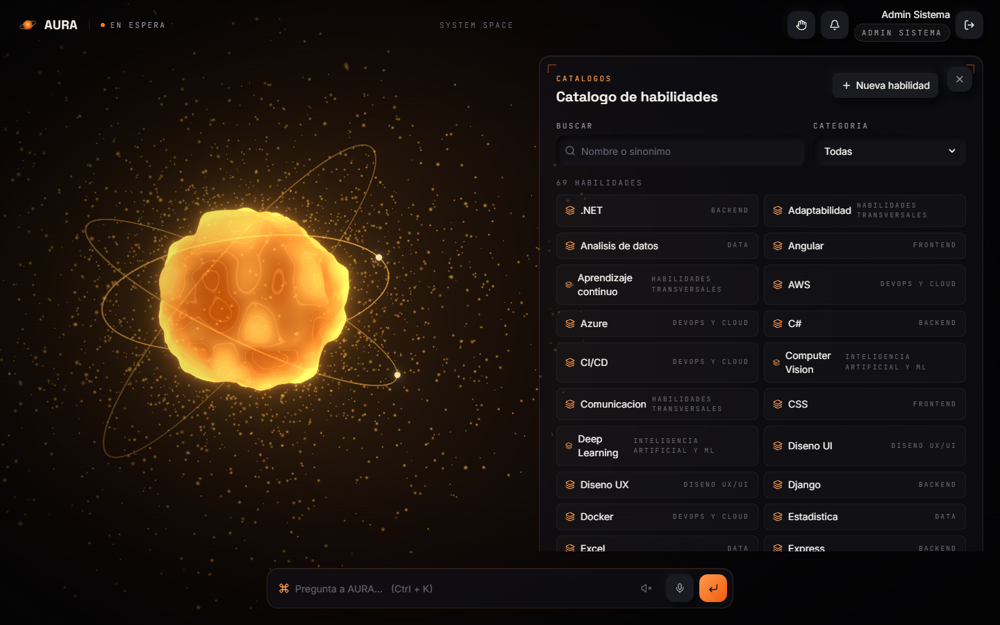

El catálogo de habilidades y sus alias (lo que la gente escribe ↔ lo que el sistema entiende) y los
recursos de aprendizaje que se ofrecen en las rutas profesionales.

---

## 8. Voz, cámara y gestos

> Estas funciones necesitan **Chrome o Edge** en una ventana normal del navegador. No funcionan dentro
> de vistas previas embebidas ni en Firefox. Todo sigue pudiendo hacerse con teclado y ratón.

### 8.1 Hablar con AURA

1. Pulsa el **micrófono** de la barra de comandos, o **Ctrl + Shift + Espacio**.
2. La primera vez el navegador pide permiso de micrófono: pulsa **Permitir**.
3. Mientras hablas, el núcleo se mueve con el volumen de tu voz y la barra muestra el texto que
   reconoce. Si no se oye nada en unos segundos, se detiene y te avisa.
4. AURA responde en texto y, si el altavoz está activado, también **en voz alta**. Cuando le hablas,
   siempre contesta en voz.
5. Al servidor solo viaja el **texto reconocido**, nunca el audio.

### 8.2 Práctica con cámara

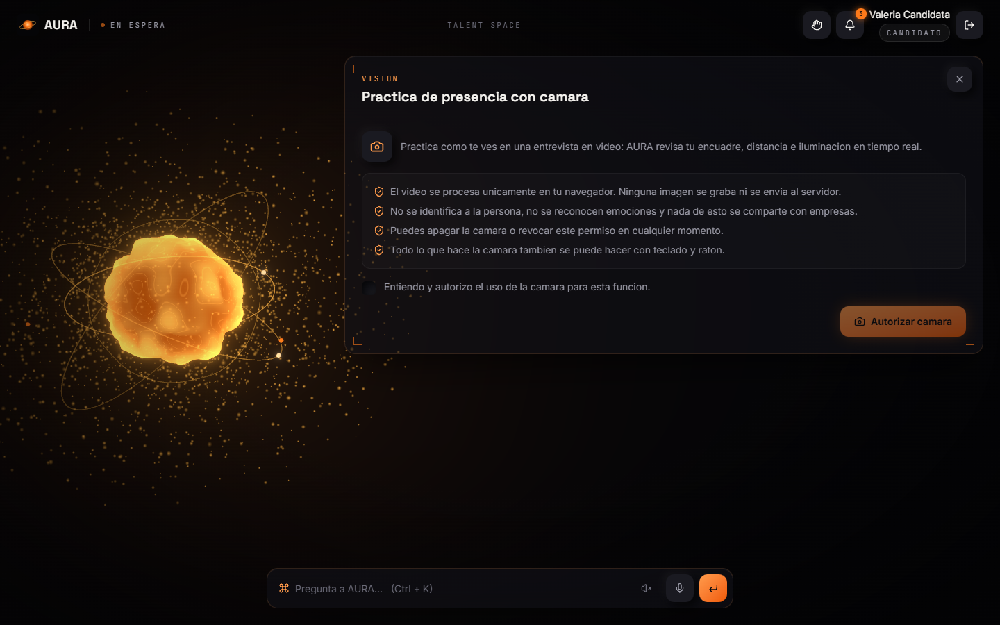

El módulo **Práctica con cámara** pide tu consentimiento explícito antes de encender nada (puedes
revocarlo en cualquier momento). Con la cámara activa, AURA detecta tu encuadre en tiempo real:

- **Centrado**: si tu rostro está en el centro.
- **Distancia**: si estás demasiado cerca o lejos.
- **Iluminación**: si la escena está bien iluminada.

Al apagar la cámara muestra el porcentaje de tiempo que estuviste bien encuadrado. El vídeo se procesa
íntegramente en el navegador: **no se graba, no se envía al servidor y no identifica quién eres**.

### 8.3 Control por gestos

Pulsa el **icono de la mano** en la barra superior. Se enciende la cámara, aparece un cursor naranja y
una ventana con el esqueleto de tu mano. Al desactivarlo, la cámara se apaga por completo.

| Gesto | Acción |
|---|---|
| Señalar con el índice | Mover el cursor |
| Pellizco (índice + pulgar) | Hacer clic |
| Dos dedos en "V" + mover la mano arriba/abajo | Desplazar la pantalla (como un joystick) |
| Palma abierta | Pausa: detiene la voz de AURA |
| Palma abierta y deslizar a un lado | Módulo anterior / siguiente |
| Puño | Volver a la pantalla de inicio |

Consejos: la mano debe verse completa y con buena luz. Para desplazar una lista interior, coloca el
cursor sobre ella antes de levantar los dos dedos.

---

## 9. Privacidad y tus datos

| Qué | Dónde se procesa | Qué sale de tu equipo |
|---|---|---|
| Cámara y gestos | 100% en el navegador | Nada. No se graba ni se envía |
| Voz | Reconocimiento en el navegador | Solo el texto reconocido |
| Resultados de orientación | Servidor | Solo tú los ves; se comparten con la empresa únicamente si lo activas |
| Notas del equipo de selección | Servidor | El candidato nunca las ve |
| Analíticas | Servidor | Solo datos agregados de tu propio ámbito |
| Pasaporte de habilidades | Servidor | Evidencias privadas por defecto; compartes cada una por separado. Credenciales importadas no se verifican criptográficamente |
| Ensayo de entrevista | Solo memoria de la pantalla | Nada: las respuestas no se envían ni se guardan en el backend |

- Cada cuenta solo accede a sus datos: un candidato no ve datos de empresa, y una empresa solo ve las
  postulaciones de sus propias vacantes.
- Las respuestas del API nunca se guardan en cachés (`Cache-Control: no-store`) por contener datos
  personales.
- **Descarga tus datos** cuando quieras: módulo Privacidad → «Descargar mis datos» (archivo JSON
  completo).
- Todas las acciones quedan en el registro de auditoría, visible para el administrador.

---

## 10. Publicar en producción

### 10.1 Requisitos del servidor

- Un servidor con HTTPS (la plataforma lo exige en producción).
- PostgreSQL accesible por el backend.
- Las mismas versiones de Python y Node de la instalación local.

### 10.2 Backend en producción

En `backend\.env` del servidor:

```ini
ENVIRONMENT=production
DB_HOST=<host> 
DB_PASSWORD=<clave>
JWT_SECRET=<clave aleatoria de 48+ caracteres>
COOKIE_SECURE=true
FRONTEND_URL=https://tu-dominio.com
CORS_ORIGINS=https://tu-dominio.com
```

**El backend se niega a arrancar en producción si la configuración es insegura** (cookies sin HTTPS,
orígenes HTTP o la URL del frontend sin HTTPS). Además, en producción la documentación del API
(`/api/docs`) queda desactivada.

Servidor recomendado:

```powershell
.venv\Scripts\python -m uvicorn app.main:app --host 0.0.0.0 --port 8000 --workers 2
```

### 10.3 Frontend en producción

```powershell
cd frontend
npm.cmd run build
```

Esto genera `frontend\dist\`: sírvelo con cualquier servidor estático (Nginx, IIS, un CDN). Compruébalo
antes con `npm.cmd run preview`, que levanta la PWA real con service worker en el puerto 4173.

### 10.4 Lista de verificación

- [ ] `ENVIRONMENT=production` y el backend arranca sin errores de configuración.
- [ ] HTTPS activo y `COOKIE_SECURE=true`.
- [ ] `CORS_ORIGINS` solo con tu dominio HTTPS.
- [ ] `JWT_SECRET` única y aleatoria (nunca la de desarrollo).
- [ ] La base de datos acepta conexiones solo desde el backend.
- [ ] Las cuentas demo eliminadas o con contraseña cambiada.
- [ ] Copias de seguridad de la base programadas.

### 10.5 Gemini opcional

Para que AURA entienda frases libres (y en el futuro, similitud semántica), consigue una clave gratuita
en Google AI Studio y añade al `.env` del backend:

```ini
GEMINI_API_KEY=tu-clave
GEMINI_MODEL=gemini-3.5-flash-lite
```

Sin clave, todo funciona con los comandos por reglas. El uso de IA externa requiere además que cada
persona active su consentimiento «IA externa» en el módulo Privacidad; cada interacción registra si se
usó el modelo (`llm_used` en `ai_interactions`).

---

## 11. Solución de problemas

| Problema | Causa probable | Solución |
|---|---|---|
| «Error al conectar» en la app | Backend apagado | Arranca el backend (puerto 8000) |
| La voz o la cámara «no hacen nada» | Vista previa embebida o Firefox | Usa Chrome/Edge en una ventana normal |
| No aparece el permiso de micrófono/cámara | Permiso denegado antes | Icono de candado en la barra de direcciones → permisos |
| El login dice «demasiados intentos» | 5 contraseñas fallidas | Espera 15 minutos |
| `psql` no se reconoce | Ruta no en PATH | Usa la ruta completa `C:\Program Files\PostgreSQL\18\bin\psql.exe` |
| `npm` no funciona en PowerShell | Política de ejecución | Usa `npm.cmd` |
| Las analíticas muestran ceros | Base sin datos | Crea vacantes/postulaciones o ejecuta `seed_showcase` |
| Los cursos no aparecen en Career Map | Falta el script 03 | Ejecuta `03_learning_resources.sql` |
| Los gestos no reconocen la mano | Mano fuera de cuadro o poca luz | Acércate, buena luz, mano completa visible |
| Puerto ocupado | Otro proceso en 8000/5173 | Ciérralo o cambia el puerto |

Para comprobar que el backend y la base están bien: `http://localhost:5173/health/ready` debe responder
`{"status":"ok","database":"ok"}`.

---

## 12. Anexo: comandos, pruebas y estructura

### 12.1 Comandos rápidos

```powershell
# Backend
cd backend
.venv\Scripts\python -m uvicorn app.main:app --reload --port 8000   # arrancar
.venv\Scripts\python -m pytest -q                                    # pruebas
.venv\Scripts\ruff check app                                         # lint
.venv\Scripts\python -m app.scripts.seed_demo                        # usuarios demo
.venv\Scripts\python -m app.scripts.seed_showcase                    # datos demo realistas

# Frontend
cd frontend
npm.cmd run dev          # arrancar (5173)
npm.cmd run typecheck    # TypeScript
npm.cmd test             # pruebas
npm.cmd run build        # build de produccion
npm.cmd run preview      # probar el build (4173)
```

### 12.2 Pruebas

- **101 pruebas de backend** (pytest) sobre una base temporal `*_test`: nunca tocan datos reales.
- **22 pruebas de frontend** (Vitest): intérprete de comandos, gestos y utilidades de interfaz.
- La suite cubre autenticación, permisos, pipeline, evaluaciones, Match, reportes, pasaporte y privacidad,
  transparencia de vacantes, seguimiento estimado, importación/exportación y seguridad.

### 12.3 Estructura del proyecto

```
Proyecto IA/
├── backend/            # API FastAPI (routers -> services -> repositories -> models)
│   ├── app/analytics/  # metricas puras (embudo, tiempos, tendencias)
│   ├── app/services/skill_passport_service.py  # evidencias opt-in y pasaporte JSON
│   ├── app/aura/       # intenciones del orquestador por reglas
│   ├── app/career/     # catalogo de roles y planificador de rutas
│   ├── app/cv/         # parser de CV y plantillas
│   ├── app/match/      # motor de compatibilidad
│   ├── app/psychometrics/ # motor de evaluaciones
│   ├── app/reports/    # generacion de PDF y Excel
│   └── app/scripts/    # seed_demo, seed_showcase
├── database/           # install.sql, 01_schema, semillas 02/03 y migración 04_trust_and_portability
├── docs/               # este manual + capturas (capturas.py las regenera)
└── frontend/           # React + Vite + TypeScript + Tailwind + React Three Fiber
    ├── src/three/      # nucleo AURA, efectos y fondo 3D
    ├── src/voice/      # motor de voz (Web Speech API)
    ├── src/vision/     # camara y modelos de vision
    ├── src/gestures/   # clasificador y controlador de gestos
    └── src/features/   # un directorio por modulo (incluye pasaporte y ensayo privado)
```

### 12.4 Regenerar las capturas

Las capturas de este manual son **reales**: las hace `docs/capturas.py`, que recorre la aplicación con
un navegador automatizado. Para regenerarlas: backend en 8000 con usuarios y datos demo
(`seed_demo` + `seed_showcase`), `npm.cmd run preview` activo y:

```powershell
pip install playwright httpx
python -m playwright install chromium
python docs/capturas.py
```

---

*Documento generado para AURA TALENT AI 1.0. Las capturas se tomaron sobre la versión real con datos de
demostración.*
